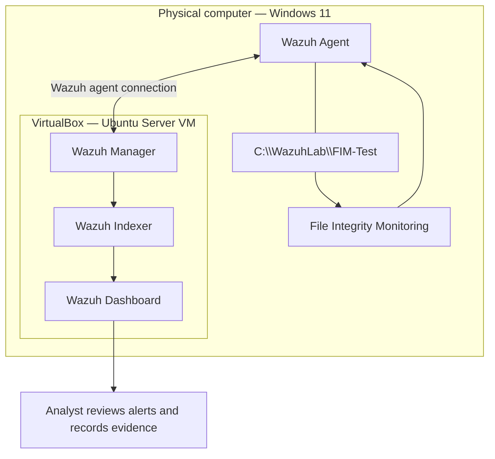

Wazuh-Based Windows Endpoint Security Monitoring & Investigation
A standalone, hands-on security monitoring lab built with Wazuh, Ubuntu Server, and a Windows 11 endpoint. The lab demonstrates centralized endpoint monitoring, File Integrity Monitoring (FIM), alert review, and basic security-event investigation.

This repository contains the lab configuration, PowerShell test scripts, deployment guide, validation procedures, and investigation templates. It is designed to be reproducible and easy to explain in an entry-level SOC interview.
Status: Implementation-ready project template. Update the evidence and results sections only after completing the lab and observing the events in your own Wazuh dashboard.

Project objectives
1. Deploy the Wazuh central components on an Ubuntu Server VM.
2. Connect a Windows 11 endpoint using the Wazuh agent.
3. Configure FIM for a dedicated test directory.
4. Generate controlled file creation, modification, and deletion activity.
5. Review the resulting alerts and identify the affected endpoint, file, action, and timestamp.
6. Record the test results and document the investigation.
Architecture

Roles
Component	Purpose
Ubuntu Server VM	Hosts Wazuh Manager, Indexer, and Dashboard
Windows 11 endpoint	Generates endpoint telemetry
Wazuh Agent	Sends endpoint events to the manager
File Integrity Monitoring	Monitors selected files and directories
Wazuh Dashboard	Displays agent status, alerts, and event details
Analyst	Validates events, investigates, and documents findings

Technology stack
- Wazuh SIEM and endpoint agent
- Ubuntu Server
- Windows 11
- Oracle VirtualBox
- PowerShell
- XML agent configuration
- Git and GitHub for project documentation
Repository structure
wazuh-windows-endpoint-monitoring/
├── README.md
├── LICENSE
├── .gitignore
├── configs/
│   └── windows/
│       └── fim-syscheck-fragment.xml
├── scripts/
│   └── windows/
│       ├── Initialize-FIMLab.ps1
│       ├── Test-FIMChanges.ps1
│       ├── Get-FIMLabStatus.ps1
│       └── Verify-WazuhAgent.ps1
├── docs/
│   ├── deployment-guide.md
│   ├── fim-configuration.md
│   ├── dashboard-investigation.md
│   ├── test-plan.md
│   ├── evidence-log.md
│   ├── investigation-report-template.md
│   ├── validation-checklist.md
│   ├── troubleshooting.md
│   └── screenshots/
│       └── README.md
└── reports/
    └── README.md
1. Prepare the lab
Hardware and network considerations
The official Wazuh quickstart recommends 8 GiB RAM for the Wazuh all-in-one host for a small deployment. A computer with 8 GB total RAM cannot safely dedicate all of that memory to a VM while also running Windows. A 4 GB VM may be constrained and may not start all Wazuh services reliably.

For this computer:
- Keep Windows responsive; do not allocate all physical RAM to the VM.
- Close unnecessary applications before starting the VM.
- Do not run additional virtual machines at the same time.
- If the all-in-one deployment is unstable, use a computer with more RAM or another suitable lab environment.
- Do not claim the deployment is successful until the dashboard and services are working.
Official sizing guidance: https://documentation.wazuh.com/current/quickstart.html
VirtualBox networking
The Windows host must be able to reach the Ubuntu VM. A host-only or bridged setup can work depending on the host network and VirtualBox configuration. Record the selected adapter mode and the Ubuntu VM's IP address in your private lab notes.

From Ubuntu, find the VM's IP address:
ip -brief address
From Windows PowerShell, test reachability:
ping <UBUNTU_VM_IP>
Replace <UBUNTU_VM_IP> with the actual address. Do not use 127.0.0.1 as the manager address on Windows; loopback refers to the local machine.
2. Install Wazuh on Ubuntu Server
Use the official Wazuh all-in-one quickstart:

https://documentation.wazuh.com/current/quickstart.html

The quickstart provides the current installation assistant and supported commands. Follow its Ubuntu instructions for the version you are installing.

The general all-in-one flow is:
sudo apt update
sudo apt install curl -y
Then download and run the installation assistant using the command currently shown in the official Wazuh quickstart. The installer deploys the central components and displays the dashboard access details.

Credential handling
- Save the dashboard password in a password manager or private offline note.
- Never commit installation archives, passwords, certificates, or private keys.
- Do not paste credentials into screenshots or issue trackers.
Open the dashboard from Windows using the HTTPS address and IP shown by the installation process. A certificate warning can occur in a self-signed home lab. Verify the address is your own VM before proceeding.
3. Install and enroll the Windows agent
Official Windows agent guide:

https://documentation.wazuh.com/current/installation-guide/wazuh-agent/wazuh-agent-package-windows.html
1. Open the Wazuh dashboard.
2. Use the agent deployment instructions for Windows and the correct architecture.
3. Enter the Ubuntu manager IP address that Windows can reach.
4. Install the agent using the official MSI instructions.
5. Start the WazuhSvc service if required.
6. Confirm the Windows endpoint appears as Active in the dashboard.
Check the service from an elevated PowerShell window:
Get-Service -Name WazuhSvc
Check the default agent log:
Get-Content 'C:\Program Files (x86)\ossec-agent\ossec.log' -Tail 30
A running Windows service alone does not prove the manager is receiving data. Confirm the agent is Active in the dashboard.
4. Prepare the FIM test directory
Open PowerShell. From the repository root, run:
Set-ExecutionPolicy -Scope Process -ExecutionPolicy Bypass
.\scripts\windows\Initialize-FIMLab.ps1
This creates:
C:\WazuhLab\FIM-Test
The directory is dedicated to this project. The scripts do not modify Windows system files.
5. Configure File Integrity Monitoring
Back up the Windows agent configuration before editing it:
Copy-Item `
  'C:\Program Files (x86)\ossec-agent\ossec.conf' `
  'C:\Program Files (x86)\ossec-agent\ossec.conf.backup'
Open the original configuration as Administrator:
C:\Program Files (x86)\ossec-agent\ossec.conf
Find the existing <syscheck> section. Add this entry inside that existing section:
<directories realtime="yes" check_all="yes">C:\WazuhLab\FIM-Test</directories>
Important:
- Do not add a second <syscheck> section if one already exists.
- Do not replace the entire configuration file with the fragment.
- Ensure the test directory exists before restarting the agent.
- Save the file and restart the service:
Restart-Service -Name WazuhSvc
Get-Service -Name WazuhSvc
Official FIM configuration reference:

https://documentation.wazuh.com/current/user-manual/capabilities/file-integrity/how-to-configure-fim.html
6. Validate the local configuration
Run:
.\scripts\windows\Get-FIMLabStatus.ps1
This checks that the test directory exists, the Wazuh service is running, and the expected directory entry is present in the agent configuration. It does not prove that Wazuh has generated or received an alert.

Wait for the initial scan and real-time monitoring to start before testing.
7. Run the FIM test
Run:
.\scripts\windows\Test-FIMChanges.ps1
The script pauses between each action so you can review the dashboard:
1. Create a dedicated test file.
2. Append content to the same file.
3. Delete the same test file.
The script refuses to overwrite an existing test file. If the previous run stopped halfway, inspect the test directory and dashboard before manually removing any leftover test file.
8. Investigate the events
Open the Wazuh dashboard and follow [dashboard-investigation.md](docs/dashboard-investigation.md).

For each event, record:
- Agent name and ID.
- Event timestamp and timezone.
- File path.
- Action reported by Wazuh.
- Rule ID, description, and severity shown by the dashboard.
- Relevant file metadata shown in the event.
- Whether the event matches the action performed.
Do not assume a specific rule ID or severity. Values can vary by Wazuh version and configuration.
9. Document the results
Complete:
- [Test plan](docs/test-plan.md)
- [Evidence log](docs/evidence-log.md)
- [Investigation report template](docs/investigation-report-template.md)
- [Validation checklist](docs/validation-checklist.md)
Add your own screenshots to docs/screenshots/. Redact private information before publishing.
Expected deliverables
Deliverable	Evidence
Wazuh deployment	Dashboard screenshot
Windows endpoint onboarding	Agent shown as Active
FIM configuration	Redacted configuration screenshot
File creation test	Corresponding event in dashboard
File modification test	Corresponding event in dashboard
File deletion test	Corresponding event in dashboard
Investigation	Completed evidence log and report

Completion criteria
The project is complete only when:
- Wazuh dashboard is accessible from Windows.
- The Windows agent is Active.
- FIM is configured for the dedicated test directory.
- Creation, modification, and deletion events have been verified in the dashboard.
- Evidence and investigation notes are complete.
Security and limitations
This is a controlled home lab, not a production SOC deployment. FIM alerts show file changes; they do not by themselves prove malicious activity. The analyst must consider context and authorization.

Keep the dashboard and agent communications restricted to the lab network. Do not monitor sensitive personal folders. Never publish passwords, agent keys, private certificates, tokens, or unredacted personal information.
Author
Muhammed Shain
GitHub: https://github.com/shain-sec
LinkedIn: https://linkedin.com/in/muhammedshain
