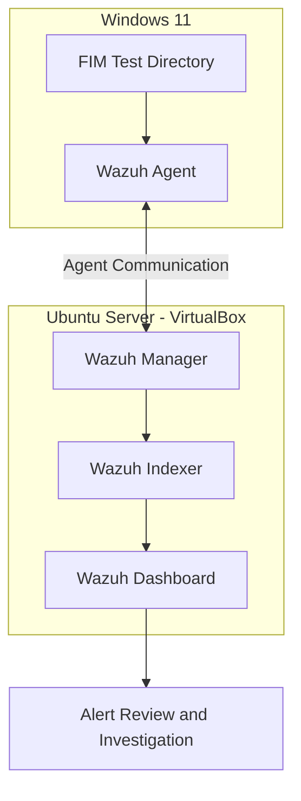

# Wazuh-Based Windows Endpoint Security Monitoring & Investigation

A hands-on security monitoring lab using **Wazuh, Ubuntu Server, and Windows 11** to monitor endpoint activity, detect file changes, and investigate security alerts.

The project covers SIEM deployment, Windows agent integration, File Integrity Monitoring (FIM), and basic security event investigation.

## Project Objectives

- Deploy Wazuh on Ubuntu Server.
- Connect a Windows 11 endpoint using the Wazuh agent.
- Configure File Integrity Monitoring (FIM).
- Monitor file creation, modification, and deletion.
- Review alerts in the Wazuh dashboard.
- Investigate events and document findings.

## Architecture



## Technologies Used

- Wazuh SIEM
- Ubuntu Server
- Windows 11
- Oracle VirtualBox
- PowerShell
- XML
- Git and GitHub

## Repository Structure

```text
├── configs/
│   └── windows/
│       └── fim-syscheck-fragment.xml
├── scripts/
│   └── windows/
│       ├── Initialize-FIMLab.ps1
│       ├── Test-FIMChanges.ps1
│       ├── Get-FIMLabStatus.ps1
│       └── Verify-WazuhAgent.ps1
├── docs/
│   ├── deployment-guide.md
│   ├── fim-configuration.md
│   ├── dashboard-investigation.md
│   ├── test-plan.md
│   ├── evidence-log.md
│   ├── investigation-report-template.md
│   ├── validation-checklist.md
│   ├── troubleshooting.md
│   └── screenshots/
├── reports/
├── README.md
```

## Implementation

### 1. Wazuh Deployment

Deploy Wazuh Manager, Indexer, and Dashboard on Ubuntu Server using the official installation guide.

https://documentation.wazuh.com/current/quickstart.html

### 2. Windows Agent Integration

Install the Wazuh agent on Windows 11 and configure it to communicate with the Ubuntu server.

https://documentation.wazuh.com/current/installation-guide/wazuh-agent/wazuh-agent-package-windows.html

Verify the agent service:

```powershell
Get-Service -Name WazuhSvc
```

### 3. File Integrity Monitoring

Configure FIM to monitor a dedicated Windows directory:

```text
C:\WazuhLab\FIM-Test
```

Add the following entry inside the existing `<syscheck>` section of the agent configuration:

```xml
<directories realtime="yes" check_all="yes">C:\WazuhLab\FIM-Test</directories>
```

Restart the Wazuh agent after saving the configuration.

### 4. Generate Test Events

Use the PowerShell scripts to create, modify, and delete test files in the monitored directory.

```powershell
.\scripts\windows\Test-FIMChanges.ps1
```

### 5. Alert Investigation

Review the generated events in the Wazuh dashboard.

Examine the affected endpoint, file path, event timestamp, operation, rule information, and alert severity.

Compare the events with the actions performed and record the investigation findings.

## Project Documentation

Additional deployment instructions, configuration details, test procedures, and investigation notes are available in the `docs/` directory.

Screenshots and investigation evidence will be added after completing the lab.

## References

- [Wazuh Documentation](https://documentation.wazuh.com/current/)
- [Wazuh Quickstart](https://documentation.wazuh.com/current/quickstart.html)
- [Windows Agent Installation](https://documentation.wazuh.com/current/installation-guide/wazuh-agent/wazuh-agent-package-windows.html)
- [File Integrity Monitoring](https://documentation.wazuh.com/current/user-manual/capabilities/file-integrity/how-to-configure-fim.html)

## Author

**Muhammed Shain**

[GitHub](https://github.com/shain-sec) | [LinkedIn](https://linkedin.com/in/muhammedshain)
